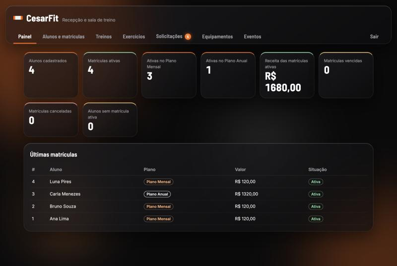
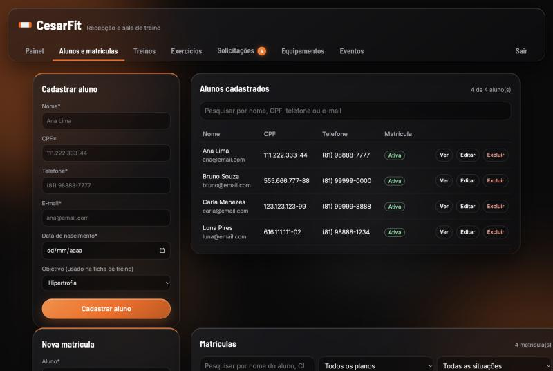
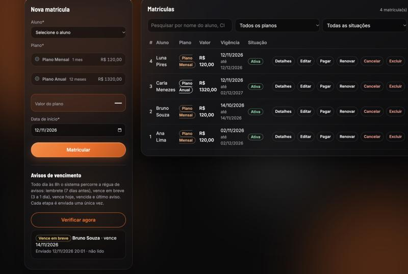
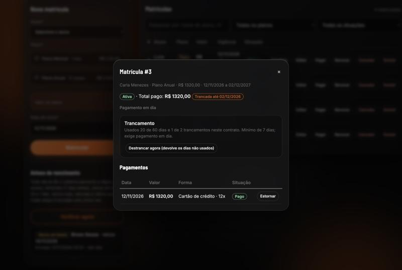
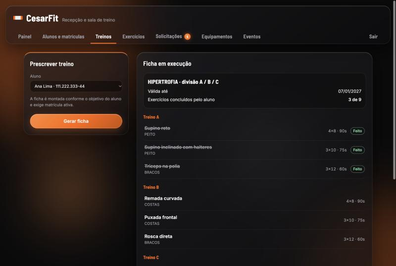
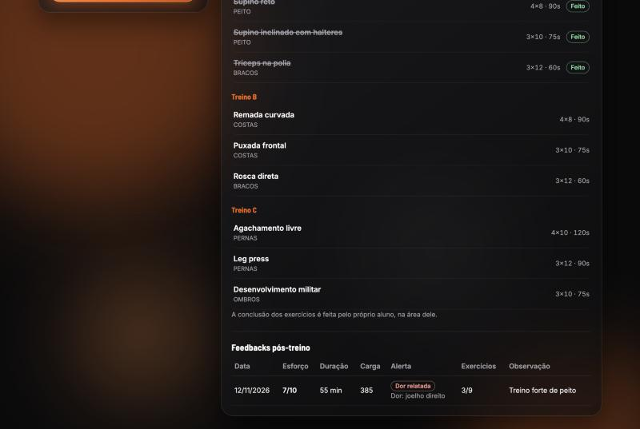
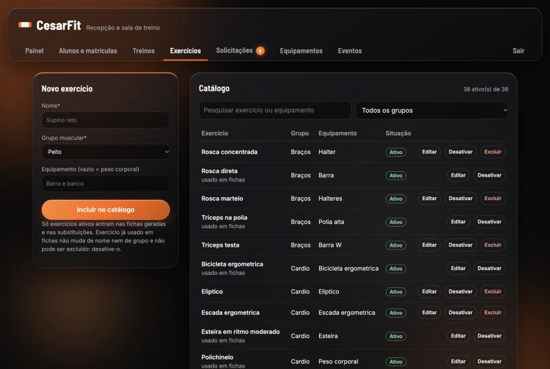
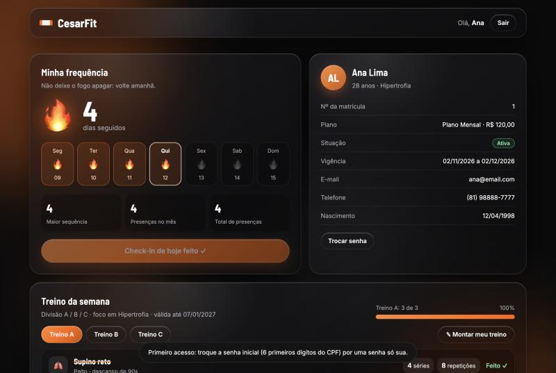

# Prototipos de alta fidelidade

As telas abaixo sao capturas do sistema funcionando, com dados de exemplo (1280 x 860).
Os arquivos estao em `docs/prototipos/`.

> Se o grupo tambem tiver o prototipo no Figma, colar o link aqui: `<link do Figma>`

## Equipe (recepcao e sala de treino)

| Tela | Funcionalidades | Imagem |
|---|---|---|
| Login | F11 Autenticacao e sessao |  |
| Painel | consulta (F4) |  |
| Alunos e matriculas - lista | F1 Gerenciamento de alunos |  |
| Alunos - menor de idade | F1 (responsavel legal) |  |
| Matriculas e avisos | F4 Matriculas, F2 Regua de avisos |  |
| Registrar pagamento | F6 Pagamentos |  |
| Detalhe da matricula | F5 Trancamento, F6 Parcelamento |  |
| Estornar pagamento | F7 Estorno |  |
| Treinos - ficha | F9 Geracao da ficha A/B/C |  |
| Treinos - feedbacks | F15 Feedback (consulta da equipe) |  |
| Exercicios | F10 Catalogo |  |
| Solicitacoes | F12, F13, F16, F8 |  |
| Analisar contestacao | F8 Contestacao |  |
| Equipamentos | F3 Ocorrencias |  |
| Eventos | consulta (trilha e eventos de dominio) |  |

## Area do aluno

| Tela | Funcionalidades | Imagem |
|---|---|---|
| Frequencia e meus dados | F14 Check-in, X4 Troca de senha, F11 aviso de primeiro acesso |  |
| Treino da semana | F9, X2 Execucao, X3 Montar treino, F13 botao Trocar |  |
| Pos-treino, solicitacoes e financeiro | F15, F12, F16, F13, F6, F8 |  |

## Fluxo navegavel

`Login` -> `Painel` -> `Alunos e matriculas` -> `Detalhe da matricula` (pagar, estornar, trancar)
`Login` -> `Area do aluno` -> `Treino da semana` -> `Pos-treino` -> `Minhas solicitacoes`
