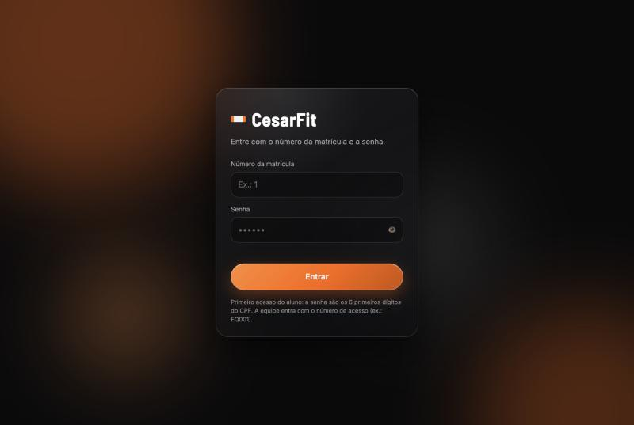
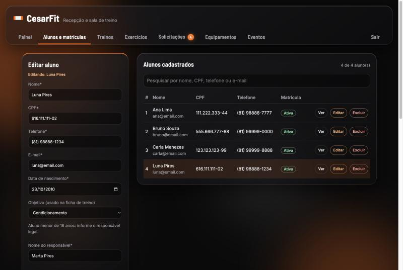
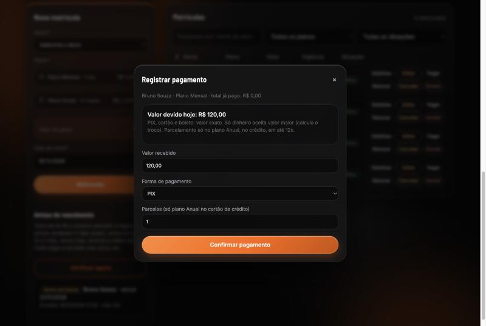
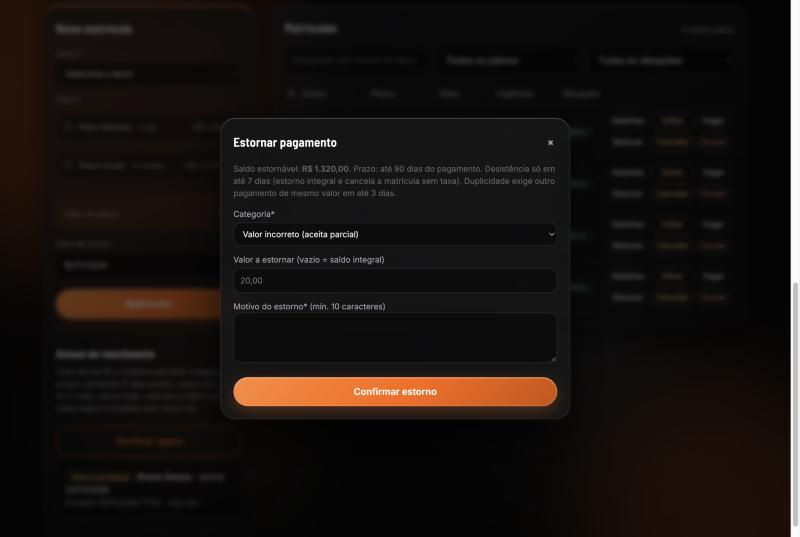
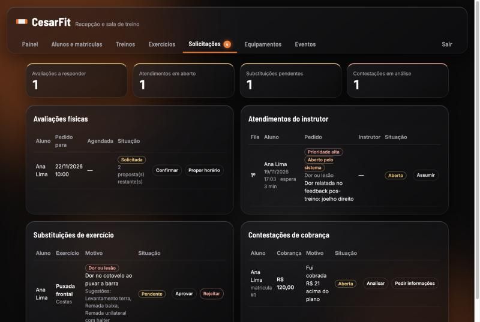
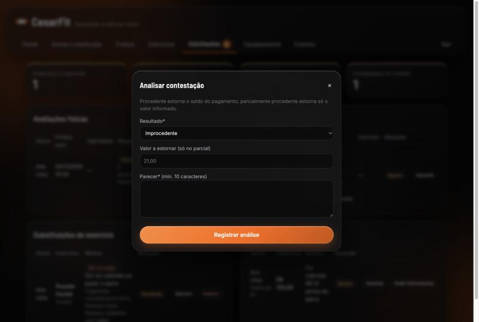
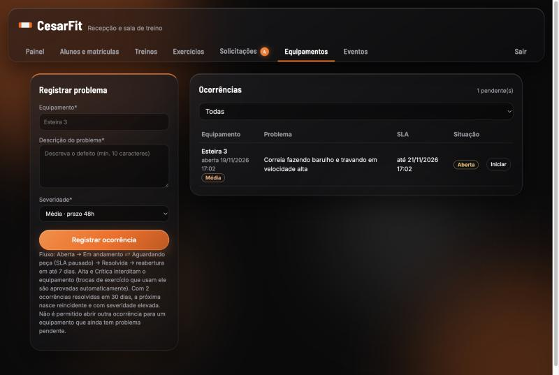
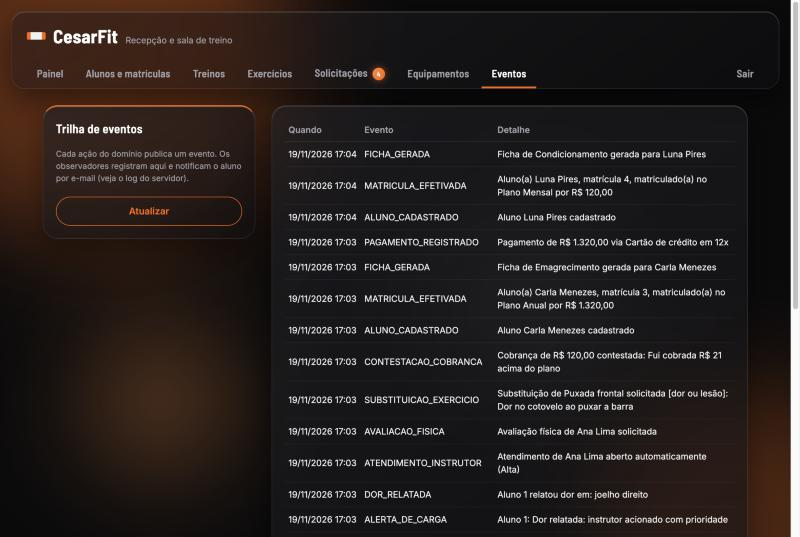
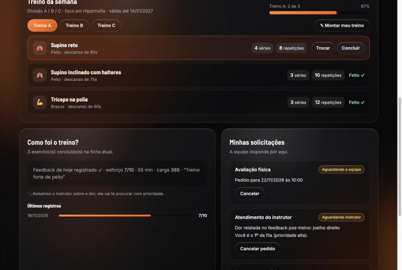
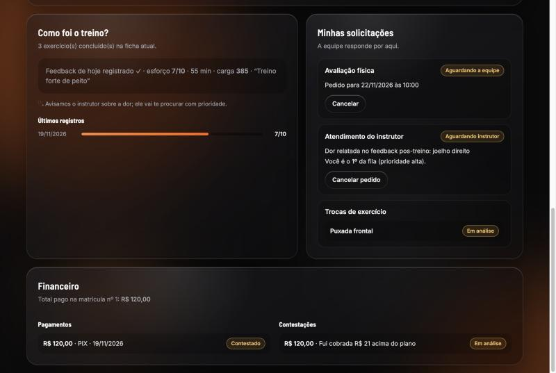

# Prototipos de alta fidelidade

As telas abaixo sao capturas de alta fidelidade do sistema funcionando, com dados de exemplo
(1280 x 860), atualizadas em 19/11/2026. Os arquivos estao em `docs/prototipos/`.
A coluna "Funcionalidade" usa os mesmos nomes da secao 2 do README (numero = integrante).

## Equipe (recepcao e sala de treino)

| Tela | Funcionalidade | Imagem |
|---|---|---|
| Login | 5 - Autenticacao e sessao |  |
| Painel | consulta (indicadores, nao contada) |  |
| Alunos e matriculas - lista | 1 - Gerenciamento de alunos |  |
| Alunos - menor de idade | 1 - Gerenciamento de alunos (responsavel legal; CPF bloqueado na edicao) |  |
| Matriculas e avisos | 2 - Efetivacao de matricula; 1 - Regua de avisos de vencimento |  |
| Registrar pagamento | 3 - Pagamentos |  |
| Detalhe da matricula | 2 - Renovacao, troca de plano e trancamento; 3 - Pagamentos (parcelamento) |  |
| Estornar pagamento | 3 - Estorno |  |
| Treinos - ficha | 4 - Execucao do treino (acompanhamento pela equipe); adicional - geracao automatica da ficha |  |
| Treinos - feedbacks | 6 - Feedback pos-treino (consulta da equipe) |  |
| Exercicios | 4 - Catalogo de exercicios |  |
| Solicitacoes | 5 - Avaliacao fisica; 6 - Atendimento do instrutor; 5 - Substituicao de exercicio; 3 - Contestacao |  |
| Analisar contestacao | 3 - Contestacao de cobranca |  |
| Equipamentos | 1 - Ocorrencias de equipamentos |  |
| Eventos | consulta (trilha de eventos de dominio, nao contada) |  |

## Area do aluno

| Tela | Funcionalidade | Imagem |
|---|---|---|
| Frequencia e meus dados | 6 - Check-in; adicional - troca de senha |  |
| Treino da semana | 4 - Execucao do treino; 4 - Montar o proprio treino; 5 - Substituicao (botao Trocar) |  |
| Pos-treino, solicitacoes e financeiro | 6 - Feedback pos-treino; 5 - Avaliacao fisica; 6 - Atendimento do instrutor; 3 - Contestacao |  |

## Fluxo navegavel

`Login` -> `Painel` -> `Alunos e matriculas` -> `Detalhe da matricula` (pagar, estornar, trancar)
`Login` -> `Area do aluno` -> `Treino da semana` -> `Pos-treino` -> `Minhas solicitacoes`
